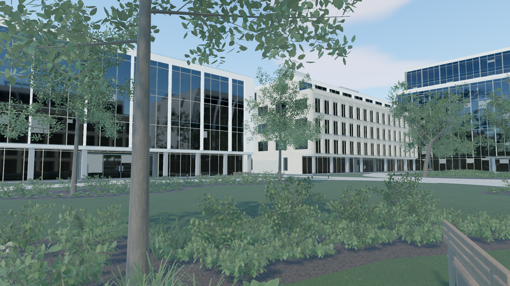
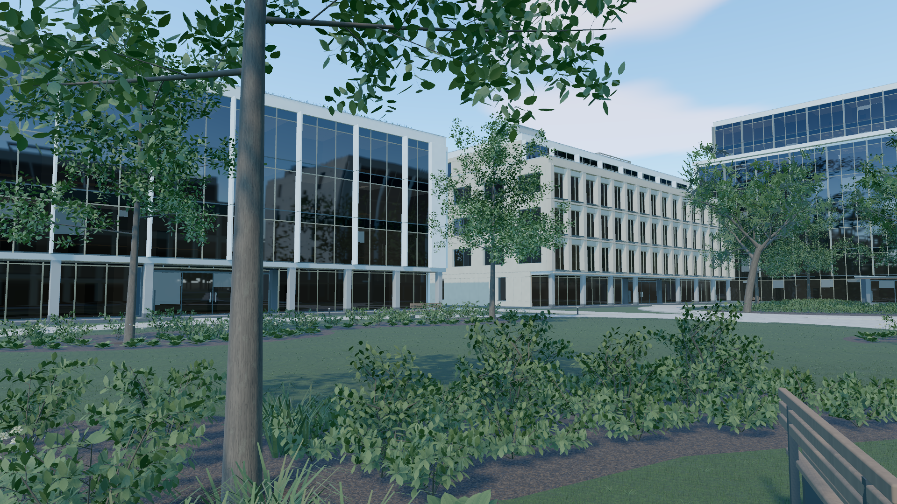
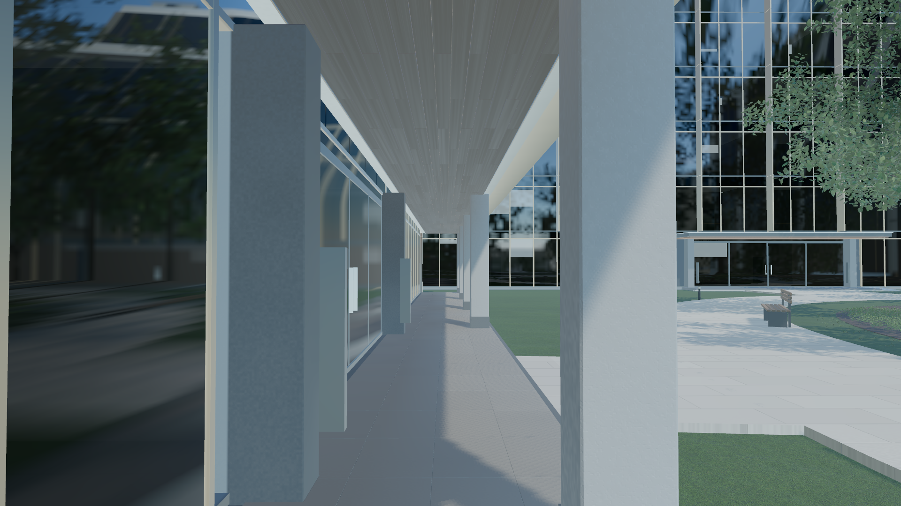
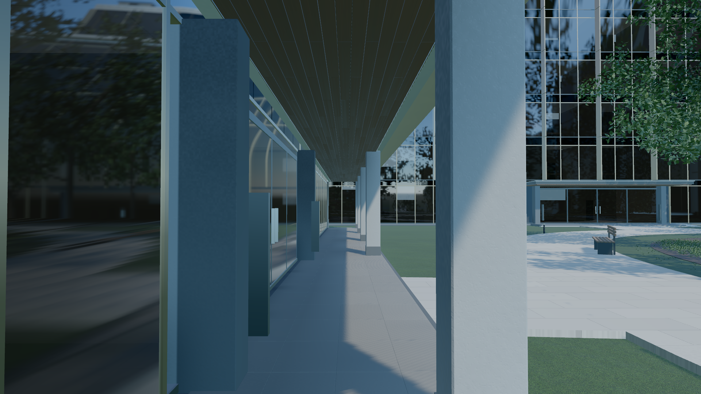

# WebGPU 实施与证据

2026-10-19。**当前状态：在已发布的流畅度版本上完成一轮写实感修复。** 保留七栋建筑、两庭院和全部程序生成的场景；完整优化及跨设备验收仍见 [总方案](WEBGPU_PLAN.md)。

## 发布前验证

### 写实感修复：可证实问题与视觉取巧

本轮优先检查了天空/地面间接光、叶片能量、玻璃粗糙度，以及接地与窗内层次。代码检查后，用真实 GPU 输出和同构图截图分别验证；没有通过增加面数或切换语言来掩盖光照问题。

| 原因 | 证据 | 本轮处理 |
|---|---|---|
| 天空 IBL 捕获把亮地平线延伸到地下，下朝表面收到过多亮天光 | 校准中下向 RGB 辐照度从 `[11.2901,14.4194,15.8307]` 修正为 `[0.7915,1.6598,1.6628]` | 仅替换 IBL 下半球为代表性土壤/草地的 Lambert 反弹；显示天空、曝光与太阳不变 |
| 叶背间接光漏乘环境强度，并丢失透射色调 | 旧实现即使环境强度为 0 仍有亮度；同一 GPU 测试在旧实现失败，修复后归零 | 与正面共用环境强度，恢复透射色调 |
| Three 默认粗糙度下限覆盖了玻璃原有变化 | 旧实现三个玻璃样本均为 `.0525`，修复后为 `.038/.040/.044` | 恢复匹配 512 像素探针的下限，保留几何导数过滤 |
| 树根和柱脚缺少细小接地关系 | 四个固定视角的独立截图复核，未见新增黑圈或错位 | 启动时生成 2048² 单通道遮蔽图，110 处接触，4 MiB；只用于地面附近矿物、土壤与草坪 |
| 部分窗户只剩黑镜面，室内辨识度低 | 1.5 倍与 3 倍填充对照；较强版本收益不足 | 仅将已有假室内填充从 `.12` 调至 `.18`，避开百叶与层间背板 |

GPU 校准共 18 项通过（光照 13 项、生产材质 5 项），原始数值见 [realism-calibration.json](webgpu-analysis/realism-calibration.json)。材质检查经历了真实的旧实现失败、新实现通过；校准关闭色调映射，以片元读回验证能量和粗糙度，不用截图亮度代替线性数值。开发服务器复现命令：

```bash
node tools/webgpu-check.mjs --lab --lighting --materials
```

几何仍为 7 栋建筑、271 个网格、9,179,037 个三角形。新增遮蔽在启动时生成，日常渲染只采样该图；没有增加每帧反射捕获或额外全屏遮蔽通道。`?groundBounce=0` / `?contacts=0` 可分别关闭下半球修正和接触遮蔽作诊断。

固定视角对比显示树冠、檐下与玻璃的层次更清楚；接地与室内填充的收益较小。仍可见重复叶形、材质重复、部分黑玻璃，以及近距离反射拉伸。本轮并未实现真实室内、通用光线追踪或照片级植被。接触图假定地面高度近零、建筑与树木静止；移动后必须重建。代表性地面反弹和假室内亮度是视觉近似，并非整个园区的物理照度校准。

验证工具现会等加载遮罩消失、相机矩阵和渲染帧稳定后截图，并记录曝光、环境强度和相机矩阵。连续漫游使用相同浏览器、GPU、1080p、balanced、MSAA、缓存阴影与探针反射作成对比较；p95 既须低于 25ms，也不得比基线增加超过 `max(2ms,10%)`。切镜和进入/退出自由相机单独记录首帧及峰值，不把稳定片段结果外推到所有交互。

成对结果见 [修改前](webgpu-analysis/realism-motion-before.json) 和 [修改后](webgpu-analysis/realism-motion-after.json)。六段中位数均约 16.6ms；修改前 p95 为 17.7–19.7ms，修改后为 17.9–20.0ms，六段均通过绝对及相对门槛。两个自然切镜窗口的最大间隔为 20.8/21.8ms，进入/退出自由相机为 22.8/21.0ms。样本较短，只证明该设备本次采样未出现明显退步，不宣称新增视觉效果提升了帧率。

发布后的 [线上复核](webgpu-analysis/realism-motion-live.json) 无页面/GPU错误，六段均低于 25ms；但最后一段 p95 为 20.4ms，比旧版单次基线的相对门槛 19.7ms 高 0.7ms，因此该报告明确保留为失败。随后用同一服务器提供两个确切静态构建，按旧/新/新/旧/旧/新顺序重新加载，最后一段每轮预热 1.2 秒、采样 5 秒。[六轮结果](webgpu-analysis/realism-last-shot-repeat.json) 中旧版 p95 为 18.3/18.5/19.5ms，新版为 18.5/18.5/18.5ms，两者中位数均为 18.5ms；未复现持续回退。这支持“短样本波动”的解释，但不抹掉线上首次相对门槛失败，也不构成统计学上的 95% 置信区间。

生产构建成功，Node 测试 26 项通过、1 项可选 GPU 测试跳过；另行运行了上述 18 项真实 GPU 校准。[生产页完整检查](webgpu-analysis/realism-production.json) 覆盖六视角、三档画质与自由相机，未记录页面/GPU错误或站外资产请求。

固定相机原始截图（相同曝光与环境强度，未后期调色）：

| 视角 | 修改前 | 修改后 |
|---|---|---|
| 25 秒：庭院植被与立面 |  |  |
| 45 秒：檐下与玻璃 |  |  |

### 移动卡顿修复与视觉优先的取舍

连续播放检查复现了原版卡顿：同为1920×1080的玻璃附近，应用帧间隔中位数约35.9ms，CPU渲染提交约35.5ms，每帧约1,745次绘制。建筑/植物加上多个反射视角及其阴影重复提交，三角形提交量达到约6,881万；这不是场景资产本身的三角形数。

当前默认使用固定世界空间阴影缓存（切镜、自由探索模式和画质变化时更新）及四个512像素反射探针，复用已有盒投影视差。没有删建筑/植物、降低画布分辨率或改变漫游路线。环境填充改为0.45，减少整体发白；这是观感取舍，不宣称物理照度校准。原动态路径可用 `?shadows=dynamic&reflections=planar` 对照。

验证命令是 `WEBGPU_URL=<页面地址> PROFILE_LABEL=before/after node tools/webgpu-motion-check.mjs`。默认25ms的参考设备帧间隔p95门槛在旧版玻璃段失败；优化版另见 [修改前](webgpu-analysis/motion-before.json) 与 [修改后](webgpu-analysis/motion-after.json) 的逐镜头原始记录。测试使用页面自身的连续漫游，每段预热1.2秒、采样2秒；没有用截图的静止帧率代替移动流畅度，也没有把RAF或CPU时间当作纯GPU时间。它不是长时间稳定性或多设备通过证明。

最终512像素反射版本的本机完整首帧约15.13秒；六镜头截图、三档画质切换与自由相机检查没有记录页面/GPU错误。Node测试21项通过，1项独立GPU校准跳过。太阳与场景保持静态是缓存成立的前提；近镜面反射仍是近似，后续风动或移动建筑必须刷新对应缓存。

### 首次预览发布记录（历史）

- 生产构建：`npm run build -- --base=/golden-temple-preview/` 通过。
- `npm run test:webgpu`：18项通过，1项需独立GPU环境的测试跳过；`npm run test:campus`：72项通过。
- 06:26 UTC以生产打包文件运行 `tools/webgpu-check.mjs`：真实WebGPU、1920×1080、七栋建筑、907个间接光探针和4个反射探针成功初始化，六个漫游视角截图完成，未记录页面/GPU错误、警告或站外资产请求。完整首帧约45.41秒，其中反射阶段约28.20秒，编译阶段约7.84秒。阶段为墙钟时间，不是纯GPU耗时。
- 该次检查证明默认页面可运行，不代表动态反射正确性、稳定60Hz、视觉质量、资源生命周期或其他设备已经验收。画面偏白和性能问题仍可见。
- GitHub源码目标：`touzi-xiansheng/golden-temple-preview` 的 `source/webgpu-preview` 分支；部署使用现有 `main` 静态文件分支与GitHub Pages HTTPS。原始上游仓库没有当前账户的写入权限。

“95%以上”没有可复现的概率模型，不能由专家主观打分来证明。本轮采用开工检查和逐阶段验收；通过基础检查表示可以推进实现，不表示最终视觉或性能已有95%的成功概率。

## 已有实机证据

- `node tools/webgpu-check.mjs --lab`：真实 WebGPU 初始化、标准节点材质实际绘制、GPU queue 完成和无 uncaptured GPU error。报告见 [lab.json](../out/webgpu/lab.json)，画面见 [lab-initial.png](../out/webgpu/lab-initial.png)。
- 本机适配器报告 `vendor=apple`、`architecture=metal-3`、`isFallbackAdapter=false`，Three 后端 `compatibilityMode=false`，支持 `timestamp-query`。
- 实际 GPU device 的默认 buffer 限制与 adapter 上限不同。后续实现使用 device.limits，不根据 adapter 最大值推断可用容量。
- 06:13 UTC的 [lab.json](../out/webgpu/lab.json) 记录9项光照校准通过，以及可见列表/CPU参照、原生间接绘制和输出像素验证通过；覆盖零实例、容量全满及独立反射视角。这是校准场景，不能代替全园区验证。
- 06:17 UTC的 [check.json](../out/webgpu/check.json) 记录七栋完整几何基线在1080p成功渲染，未记录错误；当次关闭局部间接光和局部反射。景观生成约6.77秒，编译阶段约21.16秒，首帧约28.13秒。没有受控冷热条件或同负载A/B，不能据此声明性能收益。
- 上述记录早于部分最新改动，后续恢复时须按实际源码重新验证。画面仍有整体偏白与层次不足的问题，尚未视觉验收。

## 尚须通过

1. 本轮天空下半球与生产叶片/玻璃校准已通过；完整天空/太阳比例、薄墙漏光和更多自由视角仍需检查。
2. 继续改善近距离反射、重复叶形、黑玻璃与建筑表面细节；当前静帧改善不等于整体照片级写实。
3. 将已经通过最小校准的GPU可见列表集成到完整园区，验证阴影/反射/历史和全部实例属性；同负载 A/B 后才决定默认启用。
4. 六镜头与自由视角的反射、时域、近景和外围覆盖。
5. 分阶段加载、资源释放、画质切换、设备丢失、HTTPS、现有版本回归与生产构建。

## 当前实现取舍

先由兼容适配层复用旧生成器产生几何和程序纹理，再显式转换为节点材质；不会运行旧 GLSL。转换时可读取旧 hook 的 uniform 数据，以复用闭包内的生成纹理。该步骤有意先保住完整场景及现有细节，生成与材质数据的分离和 Worker 化需后续验证，不能把当前适配层当作已经完成最终架构。

旧版入口继续可用，新版入口是 `campus-webgpu.html`；`webgpu-lab.html` 为内部校准页，不代表园区视觉验收。默认抗锯齿先使用4倍MSAA；`?aa=traa`用于相同场景实验，未经动态验证不把TRAA列为质量提升。
