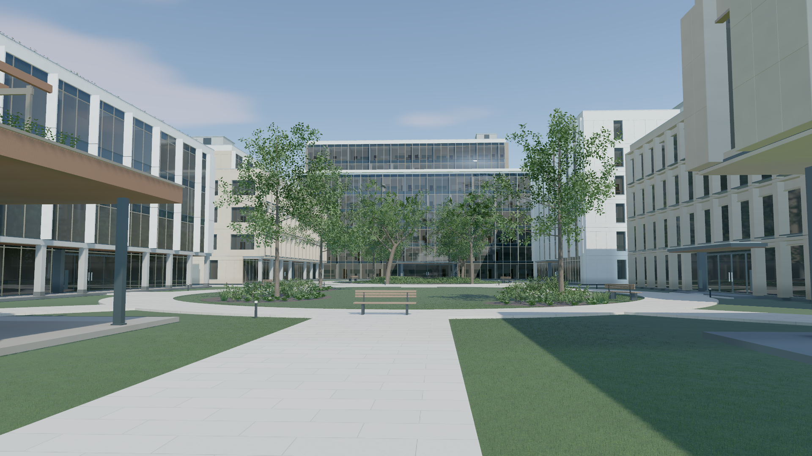
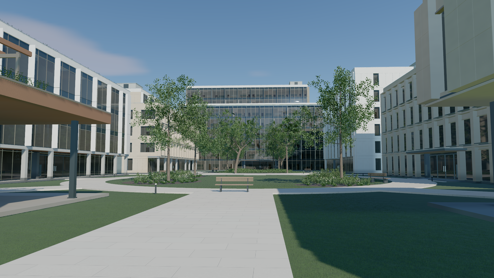
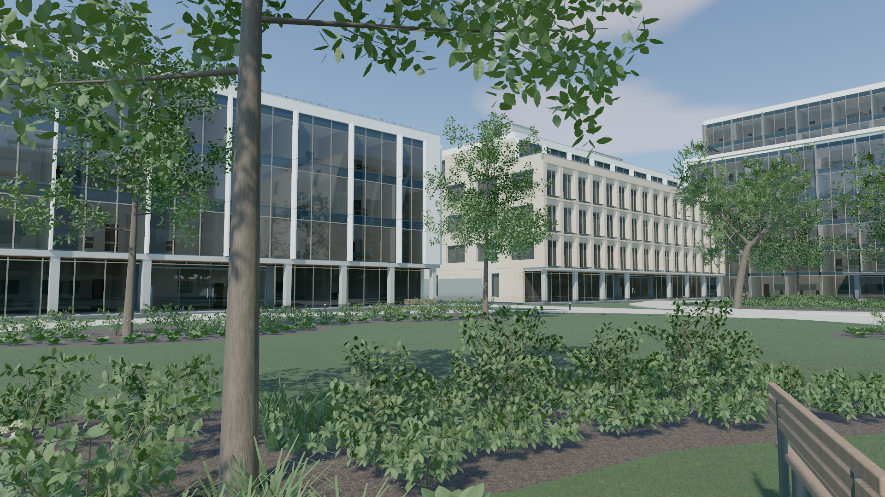
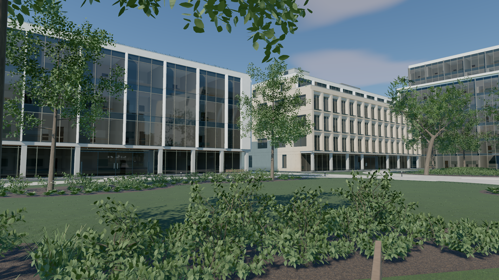
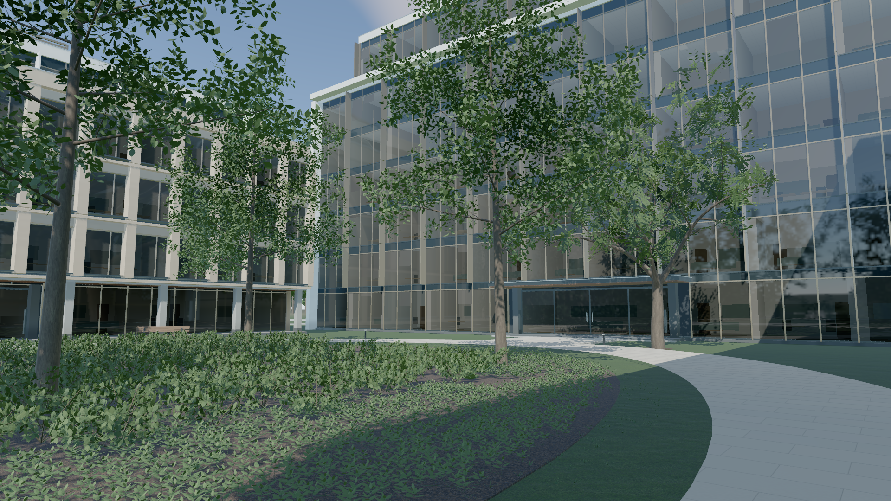
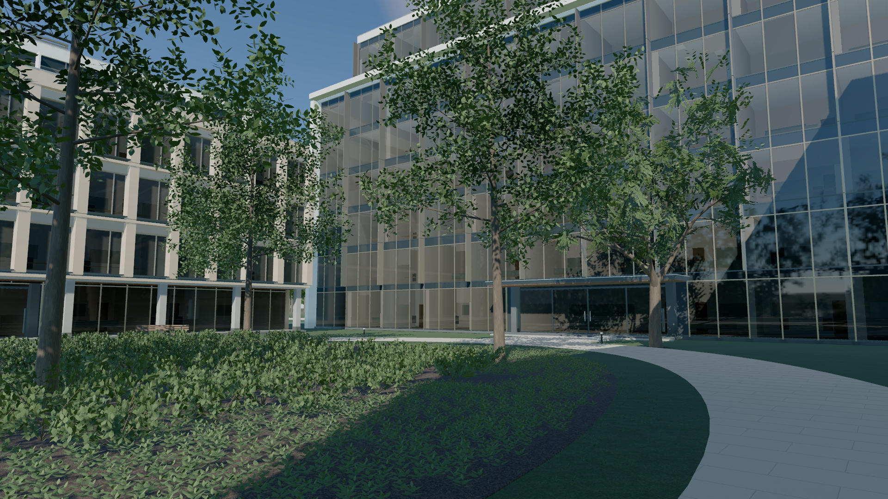
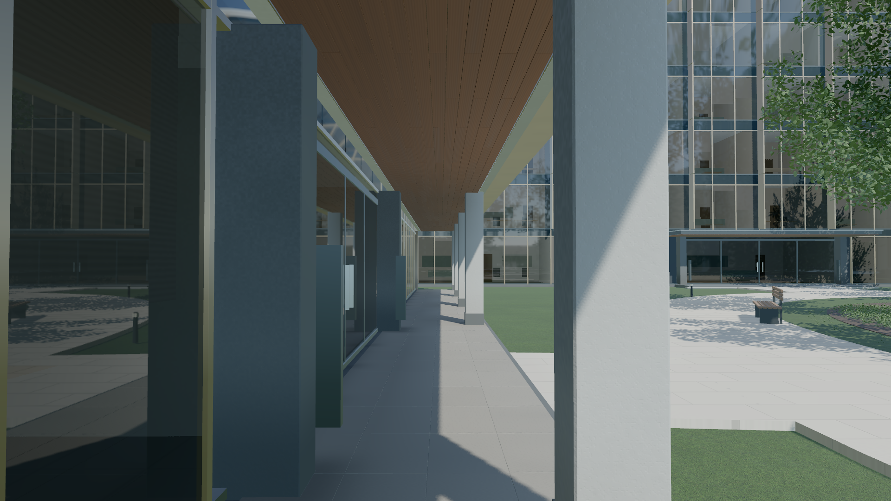
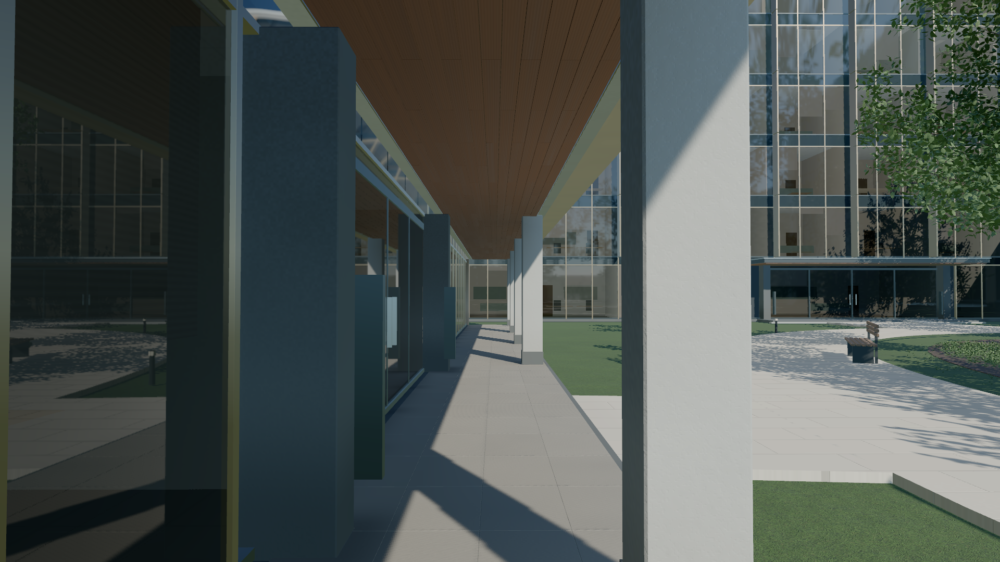

# 午后光照与庭院构图验收

本轮基线为 `9e1bbfb`。用户要求改善整体氛围，并在深入分析后实施。结论是现有明暗分区、天空填充和近树遮挡比增加渲染功能更值得先处理。最终只修改光照预设及一个共享路线控制点，继续使用程序生成场景、现有 shader、启动时生成的间接光与反射。

“审美改善的置信度 95%”没有可用的统计定义，不能宣称已测得。这里以分步实验、匿名图片比较、独立代码审查、实际 GPU 校准和新旧性能配对替代口头百分比。视觉收益和运行正确性分开验收。

## 取舍与最终参数

| 项目 | 基线 → 最终 | 目的与代价 |
| --- | --- | --- |
| 太阳仰角 | 43.66° → 35°，方位保持约 27.64° | 增加墙面、树影和廊柱的方向感；避免 30° 试验使林下入口过暗。并非每个机位都更亮。 |
| 日光线性 RGB | `(1,.97,.91)` → `(1,.93,.82)`，强度仍为 5.6 | 轻暖午后日光，与天空阴影区分。这不是等亮度色温实验，也不是统一物理色温模型。 |
| 天空 | 强度 `.4 → .28`，饱和度 `.65 → .85`，浑浊度 `2.5 → 2` | 减少填光冲淡明暗关系；阴影较深，天空更清晰。 |
| 云 | 覆盖 `.2 → .12`，密度 `.25 → .2` | 减少灰云覆盖；仍保留地平线雾感。 |
| 庭院运镜 | 20–30 秒段中点 `[13.8,1.75,43] → [13.8,1.75,41]` | 把挡住主体的近树移向画面边缘，保留上方枝叶框景。完整曲线受影响，必须检查连续路线。 |

曝光 1、AgX、雾参数、材质、反射和阴影尺寸均保留。未新增渲染 pass、纹理、资产或依赖。太阳和天空在启动前确定，整页重载后重建静态阴影、907 个 SH 探针、地面反弹、木顶和玻璃反射，以及外围遮挡；没有用运行中仅修改太阳本体的假对照。

共享路线也用于 WebGL 和近景植被生成。因此两后端都验收；WebGL 光照仍沿用原预设。路线修改使细化灌木叶片 33,252 → 34,980、草叶 300,432 → 296,412，仍在既有预算内；不能把它描述成全几何完全相同。首帧 renderer 统计仍为 45 纹理、19 render targets；该统计不是驱动实际显存峰值。

## 实验与图片证据

[参数记录](atmosphere-experiments.json)保存各候选。先试降低太阳，再比较东西侧照明、暖色、天空强度和天空外观；曝光及材质保持固定。天空饱和度、浑浊度和云量是组合实验，不能单独归因每个参数。

[匿名复审](atmosphere-blind-review.md)比较六组光照图和三组调色图。光照组采用 30° 试验版本，在五个镜头获偏好，35 秒林下入口则偏好旧版的可读性；这促成最终回调至 35°。匿名票数不能冒充最终版本的盲测结果。三组调色没有稳定独立收益，最终 **未加入输出调色**，`render.js` 保持基线版本。

航拍降高度/移向正面与廊道前移也做了构图试验。航拍在完整建筑、庭院面积和空天空之间各有代价；廊道前移大体只重复原曲线稍后的视角，均未保留。近树避让是本轮唯一保留的路线变化。

| 镜头 | 基线 | 最终 |
| --- | --- | --- |
| 入园 15 秒 |  |  |
| 庭院 25 秒 |  |  |
| 林下 35 秒 |  |  |
| 廊道 45 秒 |  |  |

[基线截图记录](atmosphere-visual-before.json)含 19 个路线帧；[最终截图记录](atmosphere-visual-after.json)含同样 19 帧、4 组同相机 local/overview 阴影对照和 3 个自由视角。所有截图使用 1920×1080、DPR 1、balanced、4×MSAA。上表四组图仅 25 秒相机改变；完整 19 帧中，20–30 秒段内部相机均受曲线变化影响。

[最终独立视觉验收](atmosphere-final-visual-review.md)支持保留当前候选：25 秒收益延续至 26–27 秒，35° 恢复了入口旁树干与背景的分离，未在受检机位发现新增显著回归；同时明确阴面更深、入口玻璃仍暗及全域阴影条带的代价。这次最终复审知道候选参数，不是匿名盲测。[独立证据复核](atmosphere-final-evidence-review.md)确认统计与 JSON 相符，并纠正了截图相机一致性的表述。

## 校准与代码检查

- [实际 GPU 校准](atmosphere-calibration.json)：23 项材质、14 项光照通过，未放松门槛。最终灰卡直射/天空比为 **3.0051**，总光 B/R 为 **1.2216**；这些美术观测值不是“更真实”的分数。探针不重复计光、零入射响应、地面反弹、遮挡和能量组合等实现不变量仍通过。
- `npm run test:webgpu`：57 通过、1 个可选 GPU 入口跳过；`npm run test:campus`：75 通过，共 132 通过。实际 GPU 校准另计，不把跳过项算通过。
- 生产构建、`git diff --check` 通过。独立代码复审未发现阻断问题，并指出既有路线测试没有覆盖树枝和座椅，因此额外检查自然播放路线。

## 交互与连续路线

- [WebGPU 自然播放](atmosphere-route-webgpu.json)：20–30 秒段记录 597 个自然帧、20 次截图；[WebGL](atmosphere-route-webgl.json)为 598 帧、19 次截图。播放期间没有 seek 或主动补绘，没有检测到时间回退、相机跳变或运行错误。截图存在采样间隔，不能证明所有帧都无几何穿插。
- 实际截图复查显示树干由中间向左退出，随后长椅退出，受检帧未见穿模。保留近树阶段的 [WebGPU 图](atmosphere-route-webgpu.png)和 [WebGL 图](atmosphere-route-webgl.png)。
- 额外按 120Hz 对新路线采样 1,200 点，检查包住真实座椅尺寸的水平包围矩形：最小间距 **0.5583 米**，发生在约 25.433 秒，见[座椅间距](atmosphere-bench-clearance.json)。这不是全场枝叶碰撞证明。
- [交互检查](atmosphere-interaction-release.json)：十轮三档画质往返、60 次视角回访、12 次自由相机进入/拖动返回，以及地面限制、启动/运行致命错误停止均通过；往返后资源数量不增长。
- [静止检查](atmosphere-idle-release.json)：九种静止状态主视图绘制与原生 GPU 提交均为零，受测交互通过自然帧唤醒。没有主动补绘帮助这些断言通过。
- [原 WebGL 完整回归](atmosphere-webgl.json)：画质、六段路线、自由探索及 context loss/retry 通过，无页面错误、外部资产请求或失败请求。两后端工具采样口径不同，不用它们的 FPS 比较后端优劣。

## 性能与波动调查

Chrome 155 / Apple Metal 3，1920×1080、DPR 1、balanced、4×MSAA。冻结基线与最终候选分别完整构建，每次使用新浏览器配置，单 GPU 浏览器串行运行。没有清空驱动缓存。以下是渲染提交结束之间的 p95 墙钟间隔，含调度，**不是 GPU 耗时或实际屏幕呈现间隔**。

三组短窗口各预热 1.2 秒、测量 2 秒。门槛保持 25ms 绝对值，以及配对旧值 `+ max(2ms,10%)`。

| 起点 | 第一组旧 / 新 ms | 第二组旧 / 新 ms | 第三组旧 / 新 ms | 延长窗口旧 / 新 ms |
| --- | ---: | ---: | ---: | ---: |
| 2 | 18.1 / 18.4 | 17.7 / 19.0 | 18.5 / 18.2 | 18.1 / 18.3 |
| 12 | 17.8 / 17.8 | 18.0 / 18.7 | 17.8 / 18.4 | 18.5 / 18.5 |
| 22 | 18.7 / 17.6 | **17.4 / 19.9** | 20.1 / 20.0 | 19.9 / 19.7 |
| 32 | 19.8 / 18.2 | **17.4 / 19.5** | 19.4 / 20.8 | 20.3 / 20.6 |
| 42 | 18.6 / 18.3 | 18.0 / 18.4 | 18.8 / 18.7 | 19.3 / 18.7 |
| 52 | 18.4 / 17.7 | 18.0 / 17.6 | 17.8 / 18.0 | 17.8 / 18.8 |

三组的 18 个新版窗口都通过绝对门槛，但第二组 22 秒、32 秒分别超过配对门槛约 0.5ms、0.1ms，**不能写成三组全部通过**。其余 16 个相对比较通过。完整保留[三组汇总](atmosphere-paired-motion.json)、第二组[基线](atmosphere-motion-before-2.json)和[失败记录](atmosphere-motion-after-2.json)。

调查发现 22 秒段新版绘制调用 163 对旧版 165，三角形约 638 万对 642 万，没有增加。该窗口旧版自身三次 p95 为 18.7/17.4/20.1ms，新版为 17.6/19.9/20.0ms，提示存在运行间波动，不能仅凭这点把失败作废。因此追加一整组 **每段测量 6 秒** 的新旧对照，仍保持原门槛、预热和采样方式；每段 359–361 帧，六项绝对与六项相对比较全部通过，见[长窗口旧版](atmosphere-motion-long-before.json)和[新版](atmosphere-motion-long-after.json)。没有继续挑选重跑结果替换原始失败。

结论是受测环境未出现持续性回退证据，不是证明所有机器性能相同。三组完整就绪均值 17.259 → 17.109 秒、首次可见 17.932 → 17.778 秒，差距很小且存在波动，不据此宣称加载提速。未新增渲染通道不等于运行耗时必然相同。

## 覆盖边界

本轮改善的是午后光感与主体可读性，不承诺照片级真实或所有机位都更惊艳。35 秒阴影依然比基线深，远景灰雾、树叶形态、部分玻璃静态反射的块化与视差仍存在。太阳盘和直接光颜色仍是美术近似。

自由探索采用全域阴影图，近景存在软化及密集条带。独立复审发现后补拍了冻结基线：同相机 [45 秒旧版全域图](atmosphere-overview-before-45.png)与[新版](atmosphere-overview-after-45.png)都有明显条带；正常导览 45 秒用局部阴影，见上表截图。补充[旧版阴影记录](atmosphere-baseline-shadow.json)及[旧版自由视角记录](atmosphere-baseline-free.json)。这是本轮仍未解决的近景自由探索质量限制，不能把自由视角功能通过等同于阴影质量通过。

证据限定于桌面 Chrome/Metal 和受测镜头。没有测 Windows、Safari、功耗、GPU timestamp 或真实显存峰值；没有将静帧审查等同于全场连续碰撞验证。实验 TRAA 不在本轮性能验收范围内。

## 发布与线上验收

- [线上预览](https://touzi-xiansheng.github.io/golden-temple-preview/campus-webgpu.html?rev=1ae31bf)。
- 源码提交 [`1ae31bf`](https://github.com/touzi-xiansheng/golden-temple-preview/commit/1ae31bfe041631c81f6cff2cbe5a8ad094a1e75c)，分支 `source/webgpu-preview`。
- 部署提交 [`2ca6483`](https://github.com/touzi-xiansheng/golden-temple-preview/commit/2ca6483c30c92eee9bb2888384b92843cdb06eb9)，[GitHub Pages 任务](https://github.com/touzi-xiansheng/golden-temple-preview/actions/runs/39545826120)成功。

- [线上资源核对](atmosphere-live-assets.json)：园区入口、原首页、实验入口、元数据及递归依赖共 24 个文件均 HTTP 200，和部署文件逐字节一致。
- [线上静止与唤醒](atmosphere-idle-live.json)：九种静止状态零主视图绘制、零原生 GPU 提交；交互自然唤醒通过，无页面错误。
- [线上交互](atmosphere-interaction-live.json)：两轮画质往返、12 次视角回访、12 次自由相机进入/拖动返回，以及地面限制和致命错误停止检查通过。

- [线上关键镜头](atmosphere-visual-live.json)：15/25/45 秒均正常，太阳参数与相机矩阵和本地候选一致。PNG 不完全相同；[像素比较](atmosphere-live-visual-comparison.json)保留差异，三帧平均绝对通道差均小于 0.006/255，不宣称逐像素一致。

部署只更新两个园区入口和对应依赖。构建元数据指向实际应用源码提交，后续验收文档提交不改变运行时代码。
