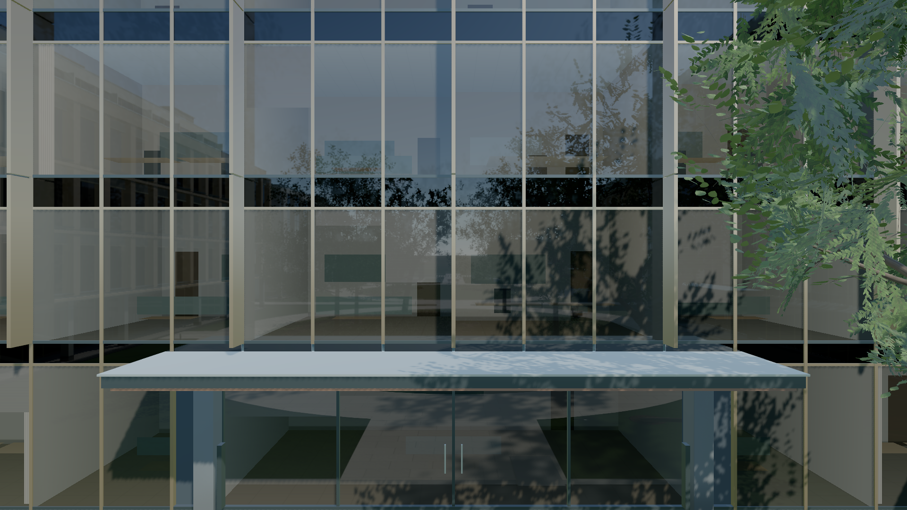
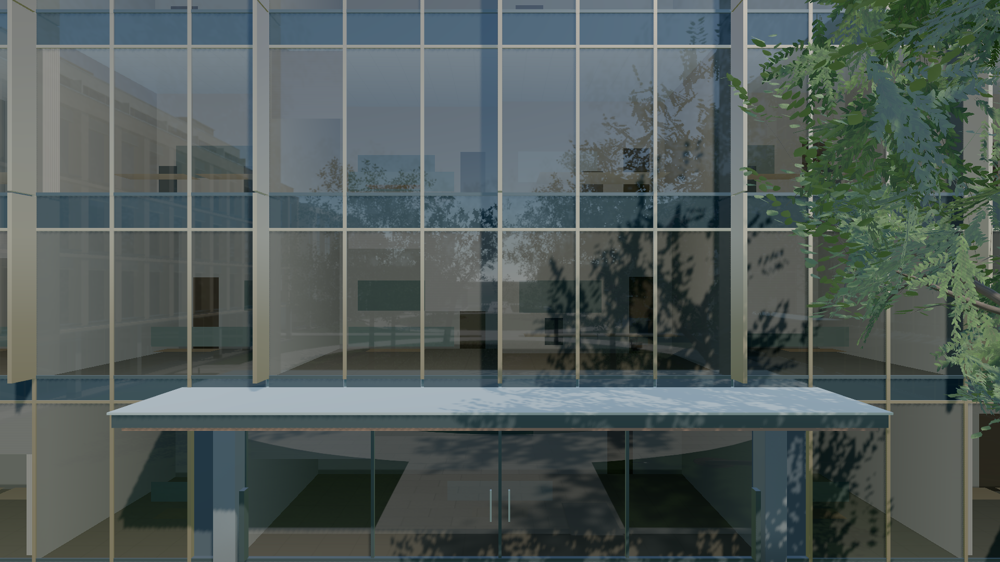
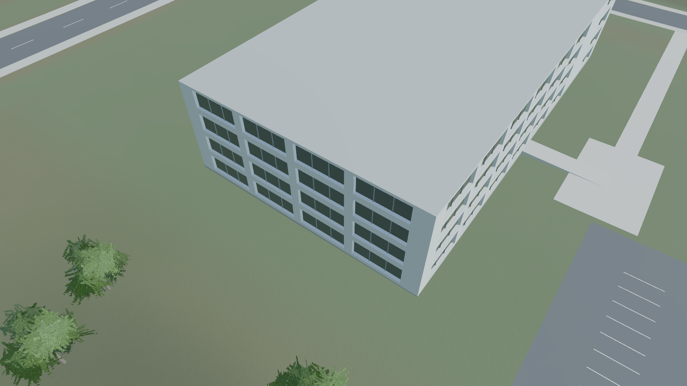
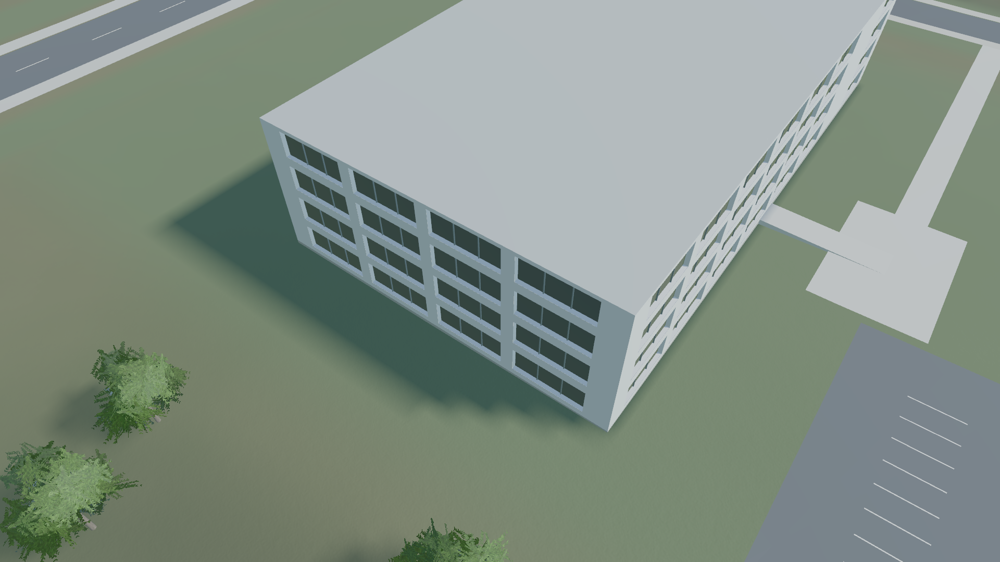

# 玻璃、外围日影和静止渲染优化验收

本轮从 `4a2ac7a` 开始，沿用程序生成场景、固定日光、TSL 材质和桌面 MSAA。保留局部对照胜出的改动，撤回没有明确视觉收益的单株叶片实验。没有引入模型、照片、HDRI、新依赖或框架升级。

“95%”没有被当作统计结论。确定性问题通过旧版失败、新版回归和独立审查确认；视觉判断通过同机位、单变量对照确认，不能把主观偏好写成数学置信度。

## 最终改动

| 改动 | 已有证据 | 代价与边界 |
| --- | --- | --- |
| 暂停按需渲染 | 原版静止 2 秒仍提交 120 帧、240 次 GPU 工作。新版九种静止状态均为零，交互通过自然绘制唤醒。 | RAF 与控制器仍更新，以保留阻尼和地面限制；实验 TRAA 仍连续渲染。本轮没有测功耗，不能换算省电比例，也不意味着移动 FPS 提升。 |
| 玻璃腰带背板受光 | paneType=1 原先返回零背板响应。使用现有 `#50646b` 的线性漫反射份额 `(1−0.3)`，经过原有两次玻璃透射路径受光。四组匿名对照均优选开启。 | 没有更改曝光、普通窗格、反射预算或整体玻璃颜色；背板镜面及多次内反射仍为近似。C 栋静态探针的块化和视差误差仍在。 |
| 外围地面日影 | 复用既有固定太阳遮挡烘焙，将纹理只乘到太阳的直接光。楼地关系在侧视明显改善；关闭太阳后，开关 atlas 的 PNG 完全相同。 | 新增 1024² R8 atlas，含 mip 约 1.33 MiB；试验烘焙约 200ms。未扩大园区阴影相机。阴影边缘较软，适合外围简化场景；太阳、地形或遮挡体变化需要重新烘焙。 |
| 林地遮罩跳过无效道路查询 | 零密度像素仍保持零，查询从 16,384 次减为 3,116 次；逐像素旧公式与新实现的整个 Uint8 遮罩一致。冻结依赖的完整生成对照也相同。 | Node 四轮交错观察到约 144ms 局部生成收益，不能据此宣称完整加载提速。 |
| 删除随后被丢弃的旧树叶生成 | 七棵已替换为完整生长图的树，不再先生成废弃的旧叶片/card。全几何、实例、统计和树冠元数据一致。 | 没有测出耗时收益，只作为冗余工作清理。对应测试保留全局与未替换树的 RNG 不变量，不再要求废弃的私有 RNG 被消耗。 |

控制器继续更新遵循安装版本的阻尼行为，并参考 [Three.js OrbitControls 文档](https://threejs.org/docs/pages/OrbitControls.html)。世界高度约束仍每帧执行，避免把上轮修好的地面限制重新放到有阈值的 change 事件内。

## 视觉对照与被否决的实验

| 项目 | 关闭 / 原状态 | 开启 |
| --- | --- | --- |
| HQ 背板受光 |  |  |
| 外围地面日影 |  |  |

玻璃对照在同一页面冻结反射捕获，再切换 `spandrelBackingStrength=0/1`。总部正视机位为 `[0,6,-40] → [0,6,-53.13]`，FOV 48；另外检查 25 秒、35 秒及 35 秒相机横移 3 米。独立复审认为开启后黑色横带不再抢过入口和树冠，仍保留室内结构与树木倒影，没有把整片幕墙统一调亮。

单株试验仅对 `(9,41)` 的树，在 refined 路径中将叶片矩阵第三基向量乘 1.5，保持根位、枝图、叶柄端点、长宽、叶数和随机序列。24/25/26 秒原尺寸匿名对照没有稳定可辨的体积收益，35 秒也无明显变化，已精确撤回这两处实验代码。当前 `whole-tree.js` 与本轮基线相同；这不等于撤回上述旧叶片生成清理。

外围日影控制图关闭了太阳后，开关 atlas 两张 PNG 的 SHA256 均为 `bc764815595654703a7a7d1313cbfb17e8510799c3ad2831dd6b5897ce7fd2b6`。该实验检验的是直接光与间接光隔离，不是全场物理光照认证。

## 真实浏览器与光照校准

- [旧版静止失败](next-idle-before.json)与[新版按需渲染](next-idle-release.json)：暂停、seek 后、探索静止、阻尼结束、滚轮后、截图后、隐藏标签页、恢复标签页、重新暂停，均检查零绘制、零原生 GPUQueue.submit，以及 ready/error 状态。
- 新版测试不主动补绘来帮助交互通过。它等待自然帧与阻尼收敛，并核对最后自然绘制的相机姿态。时间轴、自由相机、滚轮、三档画质、两种视口、截图和标签页恢复分别唤醒；恢复播放 1 秒提交约 60 帧。
- [材质与光照 GPU 校准](next-calibration.json)：23 项材质、14 项光照全部通过。新增背板检查覆盖源材质能量、0/.5/1 线性、环境强度、零入射光、遮挡、反射探针不重复计入漫反射、普通窗格不变。
- 十轮画质往返、60 次视角回访、12 次自由相机进入/拖动返回，以及地面限制和启动/运行致命错误停止均通过。资源数量没有随往返增长，详见 [交互报告](next-interaction-release.json)。
- [最终生产构建截图记录](next-visual-release.json)覆盖六个回归镜头、24/26/34/36 秒及横移。关闭太阳的 atlas 对照仍逐字节相同；园区内部 35 秒对照仅 4 个边缘像素有差异，最大通道差 4/255，其余像素一致，见 [像素核对](next-campus-pixels.json)，没有把它描述成完全逐像素相同。
- [原 WebGL 园区完整回归](next-webgl.json)通过画质、六段路线、自由探索和 context loss/retry，无页面错误、失败请求或外部资产请求。没有用两套工具不同口径的 FPS 作后端优劣比较。
- Node：WebGPU 57 通过、1 个可选 GPU 测试入口跳过；共享园区 75 通过。共 132 项通过；额外的实际 GPU 校准按上面的独立报告计数。生产构建与 diff 检查通过。

最初的开发服务器没有更新模块缓存，该轮实验因找不到新导出明确失败，已排除。后续重启并核对实际提供的三个源码模块后才采集有效对照。GPU 校准还发现上轮新增阴影资源观察器需要的 `stats.shadowResourceGeneration` 未加入两处旧测试 fixture；已补齐固定阴影代次，未通过放松生产检查来让测试通过。

## 性能：三组完整配对

Chrome 155 / Apple Metal 3，1920×1080、DPR 1、balanced、4×MSAA、固定阴影、portal 反射。每次新建 Chrome 配置，单浏览器串行 B/A 三组；没有清空系统和驱动缓存，不是严格冷驱动测试。采样时未同时运行景观生成测试或另一 GPU 浏览器。

以下 p95 是主线程渲染提交结束到下一次提交结束的间隔，包含调度，**不是 GPU 耗时或屏幕实际呈现间隔**。每段预热 1.2 秒、测 2 秒。仍使用 25ms 绝对门槛及配对旧值 `+ max(2ms,10%)`，没有放宽门槛；18 个新版窗口全部通过。

| 起点 | 第一组旧 / 新 ms | 第二组旧 / 新 ms | 第三组旧 / 新 ms |
| --- | ---: | ---: | ---: |
| 2 | 18.2 / 17.8 | 18.3 / 17.8 | 18.3 / 18.4 |
| 12 | 17.6 / 17.8 | 18.2 / 18.2 | 18.2 / 18.0 |
| 22 | 17.7 / 17.7 | 18.1 / 19.0 | 18.8 / 19.7 |
| 32 | 18.7 / 17.5 | 19.0 / 18.8 | 19.3 / 18.7 |
| 42 | 18.5 / 18.0 | 18.7 / 18.5 | 18.7 / 18.4 |
| 52 | 17.8 / 17.6 | 17.8 / 17.8 | 18.4 / 17.8 |

[配对汇总](next-paired-motion.json)，以及第一组[旧](next-motion-before-1.json)/[新](next-motion-after-1.json)、第二组[旧](next-motion-before-2.json)/[新](next-motion-after-2.json)、第三组[旧](next-motion-before-3.json)/[新](next-motion-after-3.json)保留分项与原始汇总。

完整就绪均值 **16.822 → 17.006 秒**，首次可见均值 **17.482 → 17.678 秒**。因此本轮不宣称完整加载更快。保留反射预热以防把加载成本转移到首次移动；新增外围遮挡的启动成本换来了局部画质收益。自由相机切换只要求一次自然帧，其 interval 含此前静止和协议等待，不作切换耗时结论。

独立 CPU 实验使用冻结源码目录，避免旧工具单文件基线共用当前依赖造成假对照：

- [同代码控制](next-landscape-control.json)：两组均值 4921.23 / 4910.04ms。
- [废弃树叶清理](next-landscape-discarded-work.json)：4962.03 / 4962.38ms，无可辨收益。
- [零密度遮罩优化](next-landscape-mask.json)：4922.45 / 4778.82ms，观察节省 143.63ms，约 2.92%。所有几何、索引、实例属性与生成元数据哈希相同。Canvas 被 stub，故另以完整遮罩字节 oracle 覆盖纹理数据；不替代浏览器启动测量。

## 覆盖边界

未改变静态反射探针分辨率、主阴影范围和树几何；未加入新的缓存系统、背景生成线程或渐进加载流程。玻璃远景块化、静态反射视差、外围近距离构造和首次等待仍可继续研究。

这轮证据限定于上述桌面 Chrome/Metal 环境与固定路线。没有测 Windows/Safari、长时温度、功耗、实际显存峰值或 GPU timestamp；静帧对照也不证明所有视角的帧级反射稳定性。实验 TRAA 的旧设备限制仍不在本轮验收范围内。

## 发布与线上核对

- [线上预览](https://touzi-xiansheng.github.io/golden-temple-preview/campus-webgpu.html?rev=406e680)。
- 源码提交：[`406e680`](https://github.com/touzi-xiansheng/golden-temple-preview/commit/406e680c6f528f5225352fe64bdf3a7d8d25e0b7)，分支 `source/webgpu-preview`。
- 部署提交：[`8b9ce5d`](https://github.com/touzi-xiansheng/golden-temple-preview/commit/8b9ce5de292eab6d57047cf96d7fa853b0dd768e)。[GitHub Pages 发布任务](https://github.com/touzi-xiansheng/golden-temple-preview/actions/runs/39405611775)已成功完成。
- [线上文件核对](next-live-assets.json)：两个园区入口、原首页、实验入口、构建标记及递归依赖共 24 个文件，均返回 HTTP 200，内容与部署 checkout 逐字节一致。仅更新园区入口及相应依赖。
- [线上静止与唤醒检查](next-idle-live.json)：九种静止状态均为零主视图绘制、零原生 GPU 提交；拖动与阻尼自然绘制 102 帧，其余受测动作均正常唤醒，无页面错误。
- [线上交互回归](next-interaction-live.json)：两轮画质切换与 12 次视角回访、12 次自由相机进入/拖动返回、地面高度约束，以及启动/运行致命错误停止全部通过，无页面错误。

上面的三组性能对照来自本地同机生产构建；线上验收不作为新的加载或帧率对照。部署元数据指向实际构建的源码提交，后续验收文档提交不改变运行时代码。
