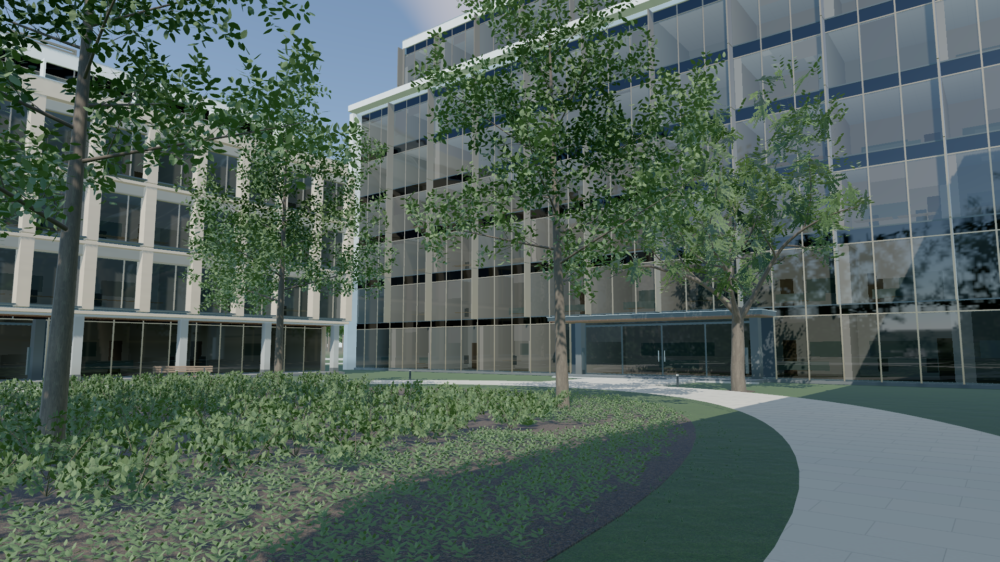
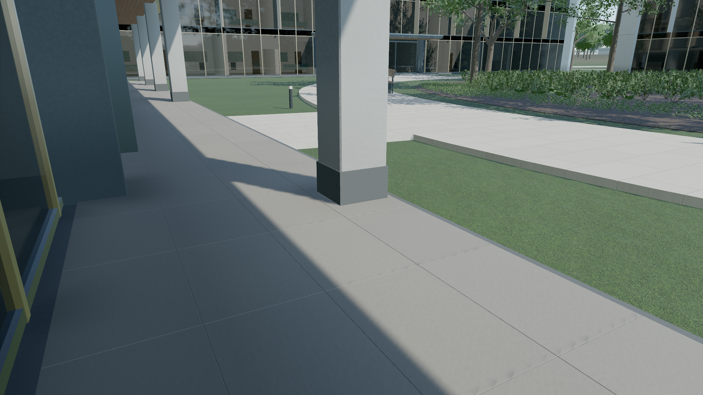
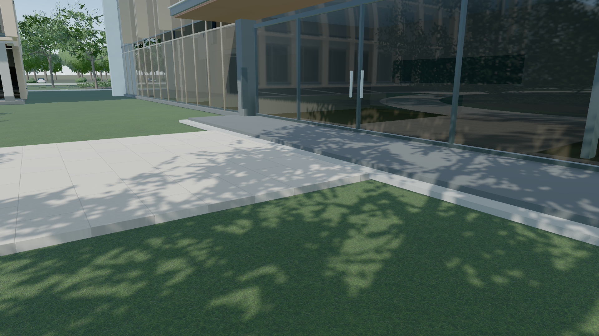
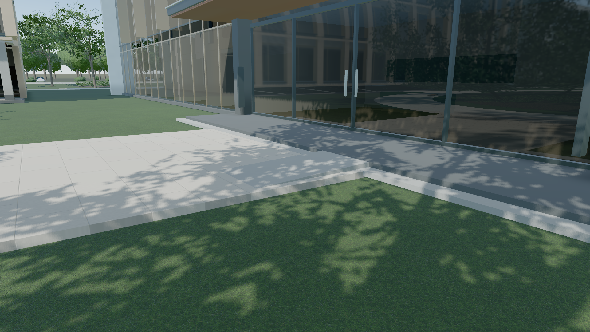

# 场景审查后的修复与验收（2026-10-20）

落实审查路线图前五项：画质往返崩溃、自由相机跳位、柱脚接触遗漏、总部玻璃倒影粗块、入口坡道断接。仍为程序生成场景、固定日光、TSL 材质，无外部模型/照片/HDRI；验收范围为桌面。

“95%”不是本轮计算出的统计置信区间。确定性缺陷以旧版失败、新版回归通过建立证据；视觉改进另做单变量对照及独立截图复审，不把主观画质判断标成数学概率。

## 因果验证和实现

| 问题 | 已验证原因与改动 | 边界 |
| --- | --- | --- |
| 画质往返崩溃 | Three r186 观察器只看到阴影尺寸。隐藏物体错过 4096→1024→4096，GPU 存储中途销毁，回来时尺寸相同而绑定未刷新。按资源代次使每个主/反射 renderObject 首次重现时完整刷新，保留原观察器、纹理身份和普通快路径。 | 固定 Three 0.186.1，升级需重验。未修改 node_modules 或全量重编译。 |
| 自由探索跳位 | 原最大极角禁止相机仰视高于自身的目标；反复切换还保留拖动惯性。改为限制世界高度，退出探索时清空惯性。 | .3m 高度下限不是完整建筑/地形碰撞系统。 |
| 柱脚接触缺失 | atlas 漏掉合并倒角 Mesh 的 416 个接地构件。逐个使用已有 componentBounds，建筑印记 46→462。 | 原 2048²、4 MiB atlas 和采样次数不变，仍为近地面接触近似。 |
| 玻璃倒影粗块 | 独立比较 HQ 探针 512→1024 与仅细化捕获阴影。前者让 35 秒右侧倒影轮廓更细，后者收益不足。只保留 HQ 1024，其余三个仍为 512。 | C 栋块化、静态探针视差误差仍在；未扩大实时反射范围。 |
| 入口坡道断接 | HQ/B/D/gallery 改为现有铺装上的闭合坡体，顶部接实际 .16m 平台/基座，底部接 .075m 道路；gallery 按外伸基座接边。 | 共享 WebGL 几何同步改变；A/C 和 commons 原方案保留，路网和种植不变。 |

[旧版实机复现](optimization-interaction-before.json) 返回六视角时再次报 `Destroyed texture ... ShadowDepthTexture`。CPU 回归使用安装版本的真实 NodeMaterialObserver 和 RenderTarget，同时保留未修复观察器的失败模式。初始化和运行中的致命错误也会停止后续主循环提交并保留失败状态。

新增坡道测试对实际三角形射线检查，覆盖三条横向轨迹、坡顶接边、两侧和底面、净空及坡脚全宽的道路支撑。建筑仍为 44 Mesh，实例增加 4、三角形增加 88；没有新增材质或景观批次。

## 玻璃实验

[三组实验](optimization-reflection-experiment.json) 使用同一旧版源码、相机、曝光、材质和 1080p 截图。有效控制图重新呈现原有块状倒影。首次试验错误调用临时 CubeRenderTarget.setSize，所得无效捕获已隔离排除，不作为结果。

HQ 升级使渲染器纹理内存计数增加 75,497,472 bytes（72 MiB，约原纹理计数的 22.3%），纹理数量不变。单次完整就绪 16.436→16.712 秒，不证明稳定启动差异。最终实际 PMREM 尺寸为 HQ 3072×4096，其余三个 1536×2048。

独立视觉复审确认 35 秒粗方块轮廓变细、树影更连贯，室内和窗框可读性保留；25 秒未见明显回归。不声称像素化已消除、画质翻倍或全园玻璃已解决。

| 视角 | 修改前 | 修改后 |
| --- | --- | --- |
| 总部倒影 |  |  |
| 廊柱接触 |  |  |
| 总部入口 |  |  |

## 性能：保留失败和配对复测

同一 Chrome 155 / Apple Metal 3、1920×1080、balanced、4×MSAA、固定阴影、portal 反射，单个 GPU 浏览器串行运行，采样期间不运行景观生成测试。

p95 是主线程渲染提交结束间隔，包含调度，不是 GPU 时间或屏幕实际呈现间隔。每段预热 1.2 秒后测 2 秒，首次/自然切镜另测。门槛始终为 25ms 绝对值和 `旧版 + max(2ms,10%)`。

| 起点 | 第一组旧 / 新（ms） | 第二组旧 / 新（ms） |
| --- | ---: | ---: |
| 2 秒 | 18.1 / 18.3 | 17.9 / 18.2 |
| 12 秒 | 17.7 / 18.5 | 17.6 / 18.2 |
| 22 秒 | 18.1 / **20.4** | 19.8 / 18.0 |
| 32 秒 | 19.2 / 19.2 | 19.8 / 18.7 |
| 42 秒 | 17.7 / 18.1 | 17.8 / 18.7 |
| 52 秒 | 18.4 / 17.8 | 19.5 / 17.9 |

第一组[旧](optimization-motion-audit-before.json) / [新](optimization-motion-audit-after.json)：新版庭院相对门槛 20.1ms，实际 20.4ms，保留失败。该次新版预编译异常耗时 19.505 秒，完整首帧 37.048 秒，未隐去。

随后连续运行第二组[旧](optimization-motion-audit-before-repeat.json) / [新](optimization-motion-audit-after-repeat.json)，全部通过原门槛；完整首帧 16.593 / 16.711 秒，预编译 .144 / .153 秒。新版首次 10/40 秒切镜峰值 20.6/19.7ms，自然切镜 20.8/26.1ms，探索进入/返回 21.5/19.7ms。

未复现持续退化，支持短窗口和环境波动的解释；仍不能排除偶发卡顿或驱动编译等待，不宣称稳态帧率或加载速度提升。首次 localhost 连接超时没有进入场景采样，随后改用明确回环地址。

## 检查范围

Node：WebGPU 56 通过、1 项可选 GPU 校准跳过；共享园区 74 通过；生产构建与 diff 格式检查通过。

[最终 GPU 交互](optimization-interaction-release.json) 全部通过：十轮三档画质往返，每次验证实际阴影尺寸并重新走六视角，共 60 次回访；资源数量没有增长。12 次首次/拖动后重入探索，最大稳定位置差约 2.6×10⁻¹⁴m、姿态差约 3×10⁻⁸rad，实际拖动有效，返回后位置/朝向/FOV 恢复。运行时故障注入后帧数 843→843；启动预热边界故障注入后提交数 8417→8417，观察 500ms，未误报 ready。这不是实际设备丢失或显存峰值测试。

[地面限制失败记录](optimization-interaction-final-confirmed.json) 中高度为 .29996597m。原 change 事件有停止阈值，不能用它约束每帧姿态；修复为每次控制器更新后夹紧高度，最终实测 .3m。保留 1μm 浮点容差，没有扩大至掩盖该失败；生产修改后重建并重新执行完整十轮测试。该调整仅在自由探索路径执行，稳态漫游性能配对使用调整前构建。

六个固定漫游镜头、廊柱近景、HQ 旧坡道位置及四个新入口均有前后截图。独立复审未发现静帧阻断：入口连续且侧面可读、未出现横断通行面的黑缝；AO 改善局部微弱，无黑圈或大片糊黑；坡面色差和硬边仍略像后加构件。不替代运动闪烁或任意低机位验证。

[旧 WebGL 入口](optimization-webgl.json) 全套真实浏览器检查通过，包含三档画质、六镜头、自由探索、完整路线和 context loss/retry，无页面错误或外部资产请求。其帧间隔统计口径与 WebGPU 运动工具不同，不作跨后端速度比较。

可选 GPU 校准没有在本轮重跑；本轮没有改变材质光照公式或 shader 采样次数。没有 Windows/Safari、移动端、长时温度、功耗或实际显存峰值测量。可选 TRAA 的旧设备顶点缓冲限制不属于本轮验收，默认仍为 MSAA。

暂停后持续渲染、完整加载耗时、远景玻璃近似和外围简化仍可后续优化，本轮不声称全部写实问题已消除。
