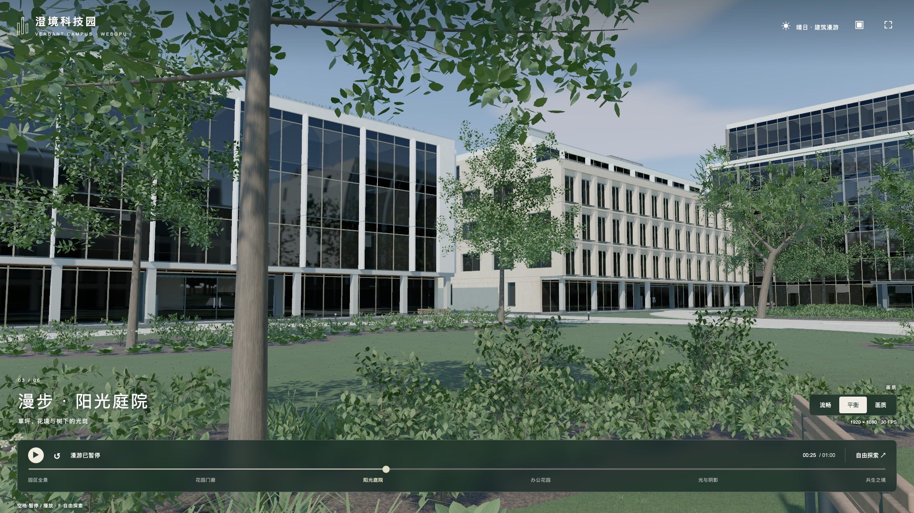
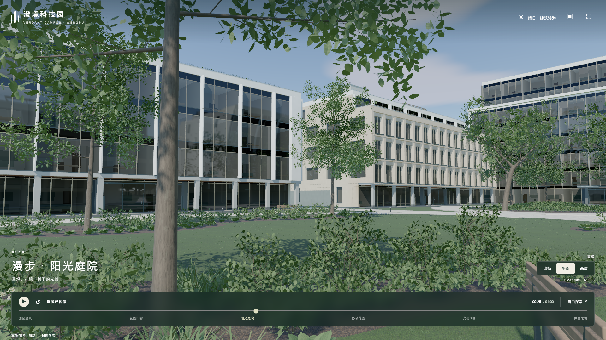
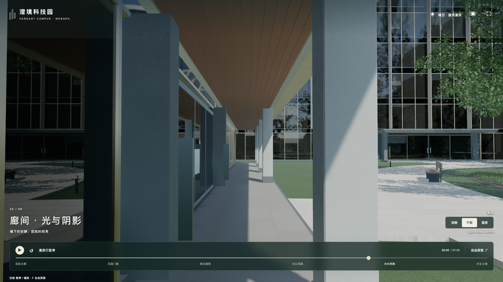
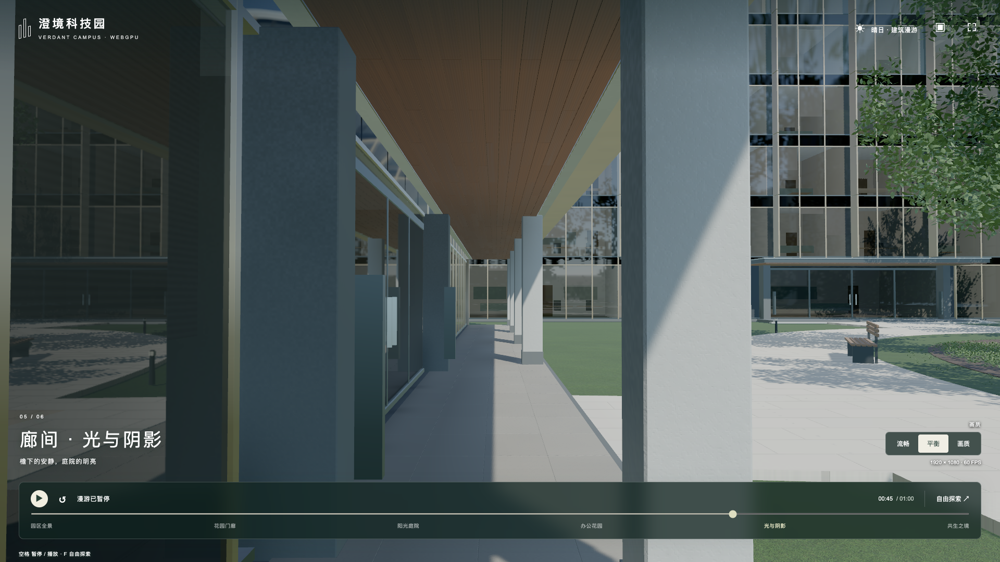
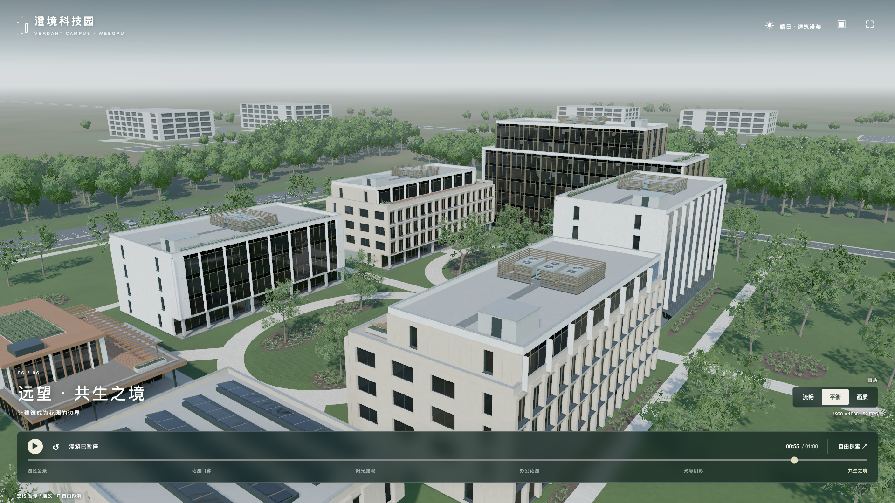
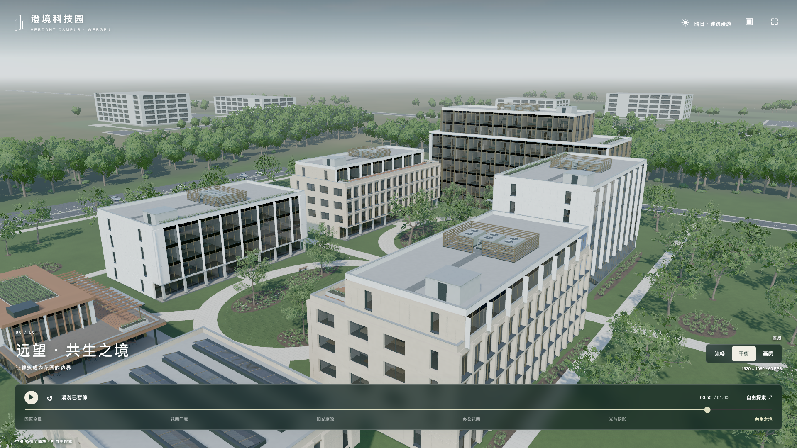

# 桌面场景细化与切镜优化（2026-10-20）

继续采用程序生成几何、TSL 材质和启动时计算的固定光照。此次没有引入模型、照片、HDRI、Rust 或移动端适配。目标是改善可见层次和已复现的等待、切镜问题；不以增加技术种类作为验收标准。

## 视觉改动

- 玻璃射线盒内增加办公、会议、休息三种布局，有限平面表达桌椅、门、背墙及侧帘。同一房间的窗格共享坐标，仍由实际日光及环境间接光照亮，无光时归零。反射、Fresnel 和穿透衰减保留。
- 树冠使用相连枝梢的色彩分组和有限的三瓣生长边界，减轻逐叶随机色的碎片感。叶柄与枝条仍相连，不扩大原有冠幅、道路净空及建筑边界。不是植物物理模拟。
- 木材增加沿板材方向的细纹，石材增加低对比层理，铺装降低高频随机色差。背景十栋建筑按整体改变高度，窗洞与遮挡代理随屋顶同步，地块与道路不动。
- 对近景玻璃条纹逐项关闭帘纹、木石纹、阴影，并进行射线定位，最终确认主要来自原百叶的高对比细纹。正弦幅度从 `.14` 改为 `.035`，均值 `.86` 保留；百叶、窗帘及室内重复线条根据屏幕导数过滤。太阳、曝光及总环境光强不变。

新增生成规则只由 WebGPU 的 `refined=true` 启用；旧 WebGL 生成器默认路径保持原行为。`?aesthetics=0` 仅关闭生成规则细化，不关闭本轮节点材质改动。

## 切镜诊断

[修改前](refine-cut-before.json) 与 [修改后](refine-cut-after.json) 使用同一浏览器、相同预采样顺序、同一第 10 秒切镜窗口，均记录 41 帧。记录的是带插桩的 CPU 提交时间，没有 GPU 等待，不能当作纯 GPU 耗时或帧率。

| 证据 | 修改前 | 修改后 |
| --- | ---: | ---: |
| 背景 NodeBuilder misses | 36 | 0 |
| 两批首次出现的植物 NodeBuilder misses | 2（19.5 / 14.3ms） | 0 |
| 切镜最慢 CPU 提交 | 42.6ms | 8.8ms |
| 该帧反射 CPU 提交 | 39.3ms | 5.6ms |
| 该帧总 draws | 490 | 490 |

原因有两处：主视图与反射来回更换天空纹理，会让 Three r186 的同一个背景材质反复重建节点图；第 10 秒首次出现的两批植物没有被原 40/45 秒预热覆盖。现在保持背景节点身份不变，每次 render 只按相机切换采样纹理，并增加第 10 秒的针对性预热。可见天空保留太阳圆盘，捕获天空仍排除圆盘。

阴影仅在世界覆盖相同的航拍/自由视角间复用，近景和分辨率变化仍重烘焙，不扩大近景阴影 texel。预热恢复相机后重置可选 TRAA 历史，防止初始画面混入预热镜头。新增预热计入完整启动时间，不能隐去后再宣称加载加快。

## 加载与证据边界

[加载对照](loading-validation.md) 记录了保留预编译的理由，以及景观生成两处热点优化。CPU 四轮对照均值从 5628.2ms 到 4950.5ms（约 12%），前后全部几何与实例属性哈希相同；该对照的两端都使用本轮细化后的场景，不能拿来证明本轮所有几何相对旧线上版本完全不变。

GPU 驱动冷热缓存、首帧编译和反射捕获仍可能主导加载。没有新增 Worker、持久化缓存框架或默认 GPU 可见列表；这些需独立证明收益。假室内、单主平面反射、远景树木与固定光照缓存仍是视觉近似，本轮不等于照片级写实。

## 最终生产验收

[GPU 校准](refine-calibration.json) 的 14 项光照、17 项生产材质全部通过，包含房间布局差异、零光归零、相邻窗格连续、木石反射率范围及百叶缩小过滤。[失败记录](refine-material-red.json) 保留了百叶校准首次失败：原采样越过百叶下沿，读到房间；修正为中心内区并额外断言实际百叶覆盖标记为 1，误差门槛没有放宽。

Node 回归 52 项通过、1 项可选 GPU 校准跳过（上述 31 项真实 GPU 已独立运行）；旧园区回归 72 项通过，生产构建成功。

[生产页检查](refine-production.json) 覆盖六个镜头、三档画质、自由相机与返回，无页面/GPU 错误、警告和外部资产请求。仍为 7 栋主体建筑、271 meshes；冠形生长改变后为 9,129,253 triangles、1,155,663 instances，略少于上一版，并非面数完全不变。

同一 Chrome 155 / Apple Metal 3、1920×1080、balanced、MSAA、缓存阴影和 portal 反射，[旧版](refine-motion-before.json) 与 [新版](refine-motion-after.json) 的连续播放结果：

| 漫游起点 | 旧版 p95 / ms | 新版 p95 / ms |
| --- | ---: | ---: |
| 2 秒 | 17.7 | 18.4 |
| 12 秒 | 17.9 | 18.4 |
| 22 秒 | 17.7 | 19.6 |
| 32 秒 | 18.3 | 18.8 |
| 42 秒 | 18.0 | 18.4 |
| 52 秒 | 17.7 | 18.1 |

全部通过 25ms 绝对门槛及 `旧版 + max(2ms,10%)` 相对门槛。这是改善视觉后维持相近运动性能的证据，不宣称稳态帧率提高。自然切镜 10 秒峰值 58.3→21.8ms，40 秒 24.5→26.1ms；自由相机进入/返回新版为 20.9/19.0ms。新增的首次入口检查在所有稳态段之前执行，10/40 秒首次切镜峰值分别为 22.6/21.0ms；旧基线没有独立的首次 10 秒检查，不能伪造直接配对。

正式运动检查没有插桩 NodeBuilder 或等待 GPU，仅测页面自身连续播放的帧交付间隔与 CPU 提交。首屏在本地生产检查中为 17.51 秒，在随后运动检查中为 16.68 秒，遮罩完全消失为 18.18/17.34 秒。旧基线完整首帧 16.45 秒；新增预热抵消了部分生成优化，不宣称整体首屏更快，也不构成受控冷启动或跨设备保证。

额外检查的实验性 `?aa=traa` 未通过：玻璃/实例材质需要 9 个顶点缓冲，而当前设备请求的上限为 8。[旧部署复现](refine-traa-baseline.json) 与 [本轮复现](refine-traa-smoke.json) 为同样错误，因此它是已确认的原有可选路径限制。该模式不属于本轮发布验收范围，不宣称它可用或已完成时域画质验证；默认 MSAA 的全部检查通过。预热后的历史重置只是代码层面的防护，不能用来掩盖此失败。

独立六图复核未发现视觉阻断。45 秒左玻璃百叶横带减弱，反射保留；25/35 秒与航拍窗内墙顶、家具层次更可读；叶群更连贯，木檐方向细纹可见而克制，石材变化较轻。近叶硬轮廓、部分远玻璃模糊和平面室内感、外围空地简化仍明显。

| 视角 | 上一版 | 本轮 |
| --- | --- | --- |
| 庭院 |  |  |
| 廊下 |  |  |
| 航拍 |  |  |

## 发布与线上复核

源码 `8163707` 已推送到 `source/webgpu-preview`，静态部署为 `1af1ddb`；[GitHub Pages 工作流](https://github.com/touzi-xiansheng/golden-temple-preview/actions/runs/39365008823) 成功。[线上资源核对](refine-live-assets.json) 确认四入口及依赖、构建元数据共 25 个文件与验收文件逐字节一致。部署时原寺庙、WebGL 入口及全部既有资源共 244 个文件保持原哈希。

[线上运动复验](refine-motion-live.json) 无页面/GPU 错误，六段 p95 为 17.9/17.8/20.1/19.5/17.9/18.6ms，全部低于 25ms；第 22 秒片段比旧基线相对门槛 19.7ms 高 0.4ms，因此保留报告为失败。首次 10/40 秒切镜峰值 20.1/23.9ms，自然切镜 21.7/23.0ms，自由相机进入/返回 22.0/22.6ms。线上本次完整首帧 21.44 秒，不把它与本地测试的 16.7–17.5 秒混称为固定加载时间。

针对这一片段，用同一服务器提供旧静态部署 `c6091af` 和本轮构建的确切文件，同一 Chrome 按旧/新/新/旧/旧/新加载六页。每页从 22 秒播放，预热 1.2 秒后连续采样 5 秒，均保持在第三镜头内。分辨率、质量、AA 与适配器字段逐项相同，每轮约 300 帧，无页面/GPU 错误。

[六轮配对结果](refine-courtyard-repeat.json)：旧版 p95 为 18.5/19.6/19.6ms，新版为 19.1/19.2/19.7ms；三轮 p95 中位数为 19.6/19.2ms，帧间隔中位数均为 16.6ms。以旧版 p95 中位数加 `max(2ms,10%)` 的门槛为 21.6ms，新版通过，每轮也均低于 25ms。未复现持续的相对门槛回退，支持短采样与运行环境波动的解释；这不删除线上首次失败，也不是统计学 95% 置信区间。
